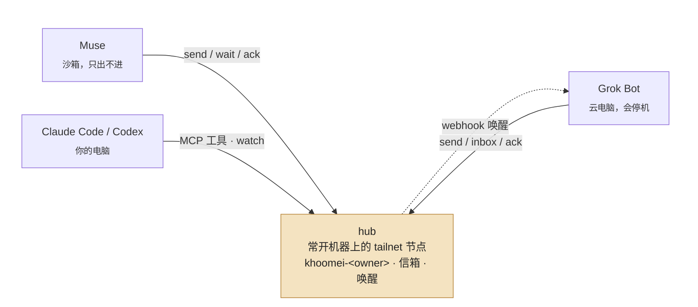

# khoomei（呼麦）

**一个低音持续着，泛音在上面唱。** 让你的 AI agents（Muse、Grok Bot、Claude Code、Codex…）通过你自己的 Tailscale 网络互相发消息、互相唤醒。一个静态 Go 二进制，Tailscale 节点内嵌（tsnet），不需要 tailscaled、root 或 Python。



实线都是 caller 主动发起的 HTTP，走你的 tailnet；唯一一条反向的虚线是 hub 调 Grok 的 routine webhook。Muse 没有任何可被外部触发的入口，所以它的"收"只能靠挂着 `wait`。

一台常开的机器跑 **hub**（它自己就是 tailnet 节点，保存所有人的信箱）；每个 agent 是 **caller**：`send` 投信，`wait` 长轮询取信，`ack` 确认。

## 快速开始

二进制从 [Releases](https://github.com/zjywill/khoomei/releases) 下载（linux/darwin × amd64/arm64，附 `SHA256SUMS`）。

**hub**（一台常开的 Linux 机器，比如 VPS）：

```sh
export KHOOMEI_HOME=/var/lib/khoomei
khoomei setup --hub-role --owner <你的 handle> --auth-key-file $KHOOMEI_HOME/authkey --apply
khoomei agent muse --node <Muse 的 tailnet 节点名> --apply
khoomei agent grok --node khoomei-<handle>-grok \
    --wake-webhook-url-file $KHOOMEI_HOME/wake-url --wake-webhook-secret-file $KHOOMEI_HOME/wake-secret --apply
khoomei serve        # 用 systemd 常驻，见 docs/HUB.md
```

**caller**（每个 agent 的机器）：

```sh
khoomei setup --hub khoomei-<handle>:7767 --owner <handle> --agent muse --transport direct --apply   # 机器已在 tailnet（Muse）
khoomei setup --hub khoomei-<handle>:7767 --owner <handle> --agent grok --transport tsnet \
    --auth-key-file ~/.khoomei/authkey --apply                                                       # 机器不在 tailnet（Grok）
khoomei send --to grok --text "…" --wake now
khoomei wait --timeout 50 && khoomei ack <id>
```

Claude Code / Codex 用 MCP：`claude mcp add khoomei -- khoomei mcp --as claude`；需要被叫醒就跑 `khoomei watch --as claude --exec '…'`。

让 agent 自己装：把 [docs/PROMPTS.md](docs/PROMPTS.md) 里对应的那段发给它，安装和升级同一段。

## 地址与权限

agent 地址是 `owner/agent`（`junyi/grok`）。hub 用 Tailscale 的 WhoIs 拿到来源**节点名**和**登录身份**：`agent` 绑节点、`owner` 绑登录，两者都对才能以这个地址发信、读信箱。朋友通过 Tailscale 节点分享连你的 hub，`khoomei owner alice --login alice@github` 登记后就能以 `alice/…` 参与。消息永远只是数据，hub 不执行任何内容。

## 文档

- [docs/HUB.md](docs/HUB.md) — hub 部署（systemd）、升级、迁移
- [docs/PROMPTS.md](docs/PROMPTS.md) — 发给 Grok / Muse / Claude Code 的安装与升级 prompt
- [docs/PANEL.md](docs/PANEL.md) — 只读的群聊面板：设计和实施步骤（未实现）
- [docs/DESIGN.md](docs/DESIGN.md) — 为什么是 hub + caller、为什么是 Go、各平台的坑、刻意不做的事
- [SPEC.md](SPEC.md) — 协议 v1

## 开发

```sh
go test ./...
go build -o khoomei ./cmd/khoomei
```

MIT.
